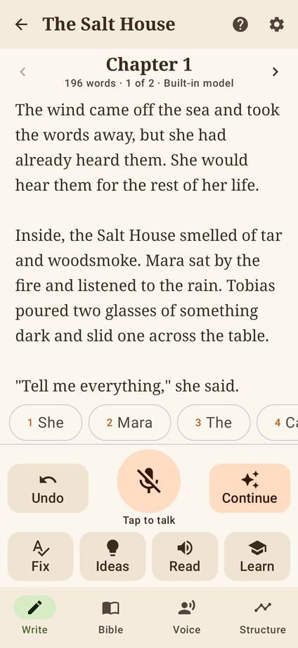
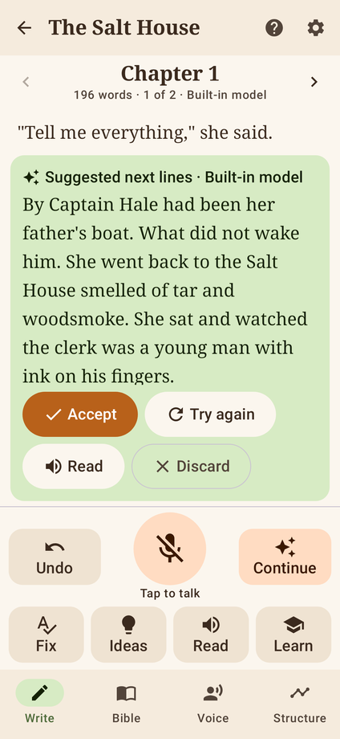
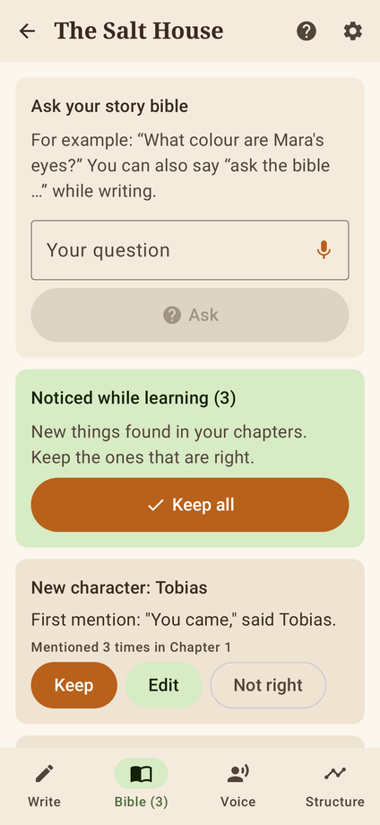
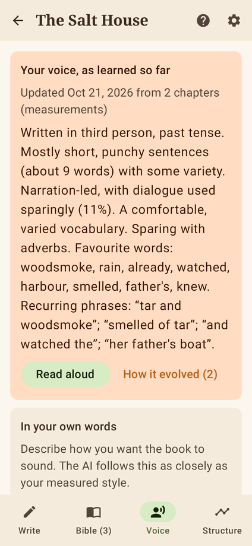

# Novel Assist

An Android app for writing a novel by voice. It slowly learns your story and the way you write from everything you dictate, and keeps a **story bible** that grows and changes as the book does.

It was made for an author whose injury makes using their hands difficult, so everything can be done by talking: dictating prose, punctuation, undoing, asking the AI to continue in your voice, accepting or rejecting what it writes, and asking questions about your own story.

<p>




</p>

## Install it on your phone

1. On your Android phone, open this repository's **Releases** page: <https://github.com/tamevillage-spec/Novel-assisting-/releases>
2. Under the newest release, tap the file ending in **.apk**.
3. Open the download. If the phone asks, allow your browser to install apps.
4. Open **Novel Assist** and allow the microphone when asked.

A new build appears on the Releases page every time the code changes. Installing a newer one keeps your novels.

Only install the app from this repository's own Releases page.

## How to use it

Tap the big microphone once and talk. With **hands-free** on (the default), it keeps listening between sentences until you say “stop listening”.

| Say | What happens |
| --- | --- |
| “comma”, “full stop”, “question mark”, “new paragraph”, “open quote”, “close quote” | Punctuation |
| “undo” or “scratch that” | Removes the last thing added |
| “continue” | The AI writes the next lines in your voice and reads them to you |
| “accept” / “try again” / “discard” | Keep it, get another, or throw it away |
| “fix that” | Corrects dictation mistakes in the current paragraph, keeping your words |
| “I'm stuck” | Three ideas for what could happen next |
| “read that back” / “read the chapter” | Hear your writing |
| “ask the bible what colour are Mara's eyes” | Answers from your story bible |
| “bible note Tobias is afraid of the sea” | Saves a fact to the bible |
| “learn this chapter” | Updates the bible, chapter summary and your voice profile |
| “new chapter” / “next chapter” / “previous chapter” | Move around the book |
| “what can I say” | Lists all of this |

Every button also has a clear label, so Android's **Voice Access** can press them for you (“tap Continue”).

## How it learns

The app doesn't retrain a giant AI model on the phone (phones can't do that). Instead it learns in four ways, all stored with your novel:

- **Your personal word model.** A small model trained only on your writing. It suggests your likely next word (the numbered chips above the microphone; say “pick two”) and powers the offline suggestions. Newer chapters count up to twice as much, so it follows your style as it changes.
- **Your voice profile.** Each time a chapter is learned, the app measures your prose (sentence rhythm, dialogue, vocabulary, point of view, tense, favourite words and phrases) and rewrites a plain-English description of your voice. Every version is kept, so you can see how your writing has evolved.
- **The story bible.** It spots new characters, places and plot threads in each chapter and asks you to keep or reject them. Nothing goes in without your say-so.
- **The story structure.** Each chapter gets a summary and a story-beat label (inciting incident, midpoint…). The Structure screen shows where you are in the book and how your pacing compares with classic story shapes.

Whenever the AI writes for you, it is given your voice profile, the relevant parts of the bible, the story so far and samples of your own prose, so it writes like you.

## Choosing the AI (Settings)

- **Built-in**: works immediately and offline. Simple suggestions built from your own phrasing.
- **On-device AI**: a full AI model that runs privately on the phone with no internet. Download it once from Settings: *Gemma 4 E2B* (2.6 GB, best, for phones with about 8 GB of memory) or *Qwen3 0.6B* (0.6 GB, for older phones).
- **Claude**: the best writing quality. Needs internet and your own API key from <https://console.anthropic.com>. Only the passages you ask about are sent.

## Your work is safe

- Saved automatically a second after you stop talking.
- Older copies are kept in a backup folder inside the app, and deleted novels are moved there rather than erased.
- **Settings → Save a copy** exports a full backup, the manuscript, or the story bible, for example to Google Drive. **Restore a backup** on the first screen brings one back.

## For developers

Kotlin, Jetpack Compose, no server. Main pieces:

| Area | Code |
| --- | --- |
| Learning (style, personal model, bible extraction, structure, prompts) | `app/src/main/java/com/novelassist/learning/` |
| AI engines (built-in, on-device LiteRT-LM, Claude via the Anthropic Java SDK) | `app/src/main/java/com/novelassist/ai/` |
| Voice (continuous dictation, commands, read-aloud) | `app/src/main/java/com/novelassist/voice/` |
| Screens | `app/src/main/java/com/novelassist/ui/` |

```bash
./gradlew :app:testDebugUnitTest   # unit tests + Robolectric walkthrough (screenshots in app/build/screenshots)
./gradlew :app:assembleRelease     # app/build/outputs/apk/release/app-release.apk
```

The GitHub Actions workflow in `.github/workflows/build-apk.yml` runs the tests and publishes each build to Releases.

The APK is signed with `keystore/novelassist.jks` (password `novelassist`), which is kept in the repository so every build can install over the last one. To use a private key instead, set `NA_KEYSTORE_FILE`, `NA_KEYSTORE_PASSWORD`, `NA_KEY_ALIAS` and `NA_KEY_PASSWORD` when building. Changing keys means uninstalling the old app first, so export a backup before you do.
